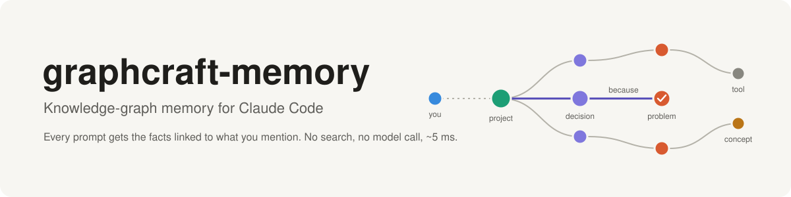
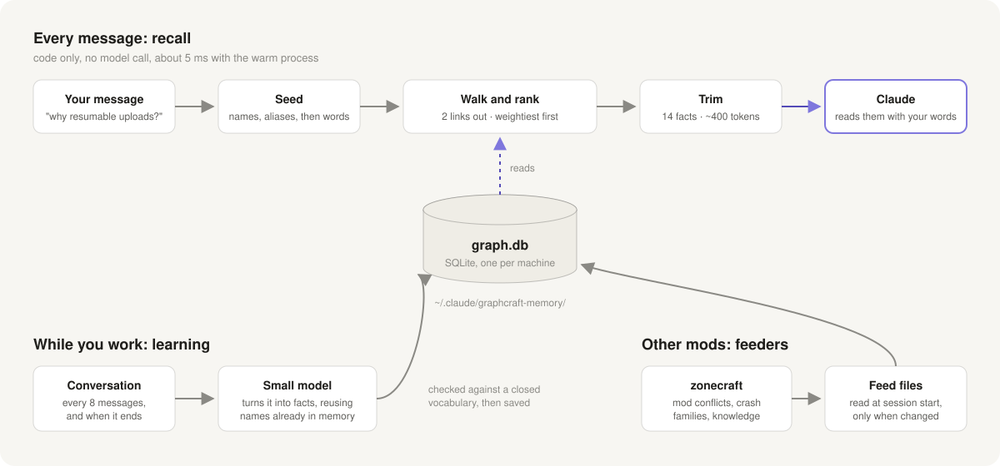

<p align="center">
  
</p>

<p align="center">
  
  
  
  
  
</p>

Claude forgets between sessions, and searching files to remember is slow and easy to get wrong. **graphcraft-memory**
keeps what you work on as a graph of connected facts: things (projects, tools, files, decisions, problems) and typed
links between them. Before every message, code looks up the things you mention, follows their links and hands Claude
the result. Claude never has to search for it.

- **Install once per machine.** One graph for all your projects in `~/.claude/graphcraft-memory/`, shared by the
  desktop app and terminal Claude Code. Nothing leaves your PC.
- **Grows by itself.** While you work, the facts worth keeping are extracted and linked in.
- **You stay in charge.** See what was used for each message, fix or forget a fact, undo a whole session.
- **Mods plug in.** With [zonecraft](https://github.com/Elusyon117/zonecraft) installed, its mod conflicts and crash
  families join the same graph.

## What Claude sees

You ask *"why did we pick resumable uploads for Tidepool?"*. Before Claude reads it, this rides along (from the demo
graph the pictures here are made from; real ones look the same):

```text
graphcraft-memory (linked to this message; may be out of date, files win):
Tidepool --[decided]--> Resumable uploads   (s:654a0668)
Resumable uploads --[because]--> Upload timeouts   (s:654a0668)
Upload timeouts --[fixed_by]--> Resumable uploads   (s:654a0668)
Tidepool --[decided]--> Server-side rendering   (s:9c090f94)
Tidepool --[uses]--> Postgres   (s:9c090f94)
…
where:
  Resumable uploads: Uploads go in 5 MB chunks that can resume.
  Upload timeouts: Large photos hit the 30 s request limit.
```

Every fact says which session (or mod) it came from, so it can be traced and taken back out.

**What it costs.** About 350–450 tokens on a message that names something you have worked on, nothing on one that
does not ("yes, release it"). Facts already given earlier in the session are not sent again (they are still in the
conversation), so follow-up messages cost much less: on eight typical messages in one session, about 2,000 tokens in
all. The two tools add about 1,100 tokens to each request (cached). Learning runs as a separate small-model call, not
in your conversation, and the pane, map and settings cost no tokens at all.

## How it works

<p align="center">
  
</p>

1. **Every message: recall.** Names and aliases you mention (or, when you name nothing exactly, the words you use:
   "that sleeping mod that clashed with us" finds Bedroll Mod) seed a walk two links out. Facts are ranked: what you
   named first, then weighty links (decisions, reasons, problems, preferences) over light ones, this project before
   others. The top 14 go to Claude. No model is called; with the warm process it takes about 5 ms.
2. **While you work: learning.** Every 8 of your messages, and when a session ends or compacts, a small model (Haiku
   by default) turns the new part of the conversation into facts. It is shown the names already in memory so it
   reuses them, and everything it returns is checked against a closed vocabulary before it is saved.
3. **Other mods: feeders.** A mod drops facts into feed files; they are read at session start, only when changed.

The full design is in [docs/DESIGN.md](docs/DESIGN.md).

## The map

`/graph-view` opens an offline map of the whole graph in your browser: one HTML file, no network.


**Structured** puts each kind of thing in its own column and each project in its own band (click a band to fold it).
Hover a node to light its links, click it for its facts and where they came from.

<table>
<tr>
<td width="50%">


<b>Find</b> keeps matches lit; Enter jumps to the next one. Double-click centres on a node.
</td>
<td width="50%">


<b>Free</b> is a web you can drag apart. <b>Why chains</b> keeps only decisions and their reasons.
</td>
</tr>
</table>


The **Timeline** tab lists every session newest first: what it taught, what has been retired since, and "Show on map"
to light just its facts. Sessions are named for what happened in them; ✎ renames one.

Getting around: drag to pan, the wheel scrolls (Ctrl+wheel zooms), the corner overview moves you anywhere, and keys
work too: arrows, `+`/`-`, `0` to fit, `/` to find, `?` for the list. A link can open a view directly:
`graph.html#layout=free`, `#tab=time`, `#focus=Tidepool`, `#q=upload`.

## The Memory pane

The pane opens beside the chat (`/graph-pane` brings it back after you close it):

- **Used for this prompt:** the facts Claude was just given. **Forget** retires one; **Fix** lets you pick the right
  link or tell Claude what is true.
- **Learned recently:** what the latest capture added. **Keep**, **Drop**, or **Undo session**; **Rename** names the
  session.
- **Problems:** this project's open and fixed problems, and what fixed them.
- A **search box** over everything remembered, and **Open map**.

Clawd sits in the corner with a memory bubble that draws the recall walk. With the clawd-pet mod installed he uses that
mod's frames, read from your install and never copied here; otherwise a stand-in.

## Install

You need **Python 3** on the PC (python.org, with "Add to PATH" ticked) and access to this repository on GitHub
(it is private: the owner invites you, and Git on your PC must be signed in to GitHub, for example through GitHub
Desktop).

In a Claude Code terminal session, type:

```
/plugin install graphcraft-memory --marketplace Elusyon117/graphcraft-memory
```

Answer `y` to add the marketplace, then pick the **user** scope so it loads in every session. From a shell instead:

```bash
claude plugin install graphcraft-memory --marketplace Elusyon117/graphcraft-memory
```

**Desktop app:** click **+** next to the prompt box → **Plugins** → **Add marketplace** → `Elusyon117/graphcraft-memory`
→ **Add plugin**.

Update later with `claude plugin marketplace update elusyon-graphcraft-memory`, then
`claude plugin update graphcraft-memory@elusyon-graphcraft-memory`.

## Commands and tools

| Command | What it does |
|---|---|
| `/graph-view [project]` | Open the map (optionally on one project). |
| `/graph-pane` | Bring the Memory pane back. |
| `/graph-memory` | What is remembered, and recent captures. |
| `/graph-memory-undo [session id]` | Take a session's facts back out (default: the last one). |
| `/graph-rename <session id or last> <name>` | Give a session your own name; later captures keep it. |
| `/graph-merge [<name> into <name> | undo]` | List nodes likely saved twice under two names, join one pair, or undo the last join (also in the pane's Duplicates section). |
| `/graph-export` | Save all memory to one file in Downloads. |
| `/graph-import <file>` | Merge an export on another PC (a copy of the graph is kept first; importing twice changes nothing). |

Claude also gets two tools: `memory_search` digs further than the automatic recall, and `memory_remember` saves a
decision, fix or preference the moment it is settled, under the current session, so undo takes it out like any
capture.

## Settings

In the mod's settings; they apply from the next session.

| Setting | Default | What it tunes |
|---|---|---|
| Facts per prompt (`recallFacts`) | 14 | How many facts ride along with each message (1 to 40). |
| How far recall reaches (`recallDepth`) | 2 | 1: only facts about what you named. 3: their wider surroundings too. |
| Recall from other projects (`otherProjects`) | on | Off: only this project's facts and global ones. |
| Kinds of things not to remember (`skipTypes`) | none | e.g. `PERSON, PREFERENCE`: neither learned nor recalled (saved ones stay, hidden). |
| Learn from conversations (`capture`) | on | Off: recall only. |
| Learn during the conversation (`captureEvery`) | 8 | Also learn after every this many of your messages; 0 for only at the end. |
| Extraction model (`extractModel`) | haiku | `sonnet` catches subtler facts and costs more. |
| Keep recall warm (`warmRecall`) | on | Off: Python starts fresh for each message (about 150 ms instead of 5). |
| Map opens in (`mapLayout`) | Structured | Or Free. |

## Other mods

With zonecraft installed, its last mod-conflict check and the crashes its watcher classified become facts: which mods
override or patch which asset, who wins, which crash family hit which mod and where the advice is. So "it crashed at
the campfire" brings them back. To make your own mod a feeder, see [docs/DESIGN.md](docs/DESIGN.md) § Feeders.

## Develop

```bash
py -3 -I tests/test_graph.py            # each tests/test_*.py runs on its own
claude plugin test .                    # the hook tests
claude --plugin-dir .                   # a session with the mod loaded from this folder
py -3 -I docs/images/make_images.py     # remake the README pictures (headless Edge or Chrome)
```

Set `GRAPHCRAFT_DB` to a scratch path to keep test facts out of your real graph. The pictures come from a made-up
demo graph ([docs/images/demo_graph.py](docs/images/demo_graph.py)), never from real memory.

## Credits

The push-recall design (typed graph in SQLite, recursive walk, prompt-hook injection) follows the ideas published by
Glitch Cat Club in [graph-memory-starter](https://github.com/Glitch-Cat-Club/graph-memory-starter) (MIT). This repo
is an independent implementation.

## License

MIT
